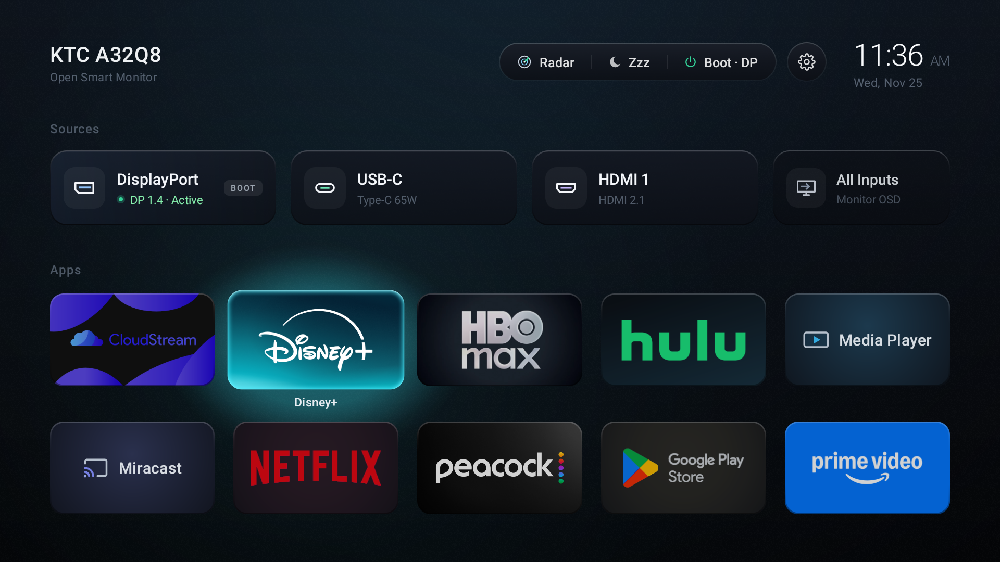
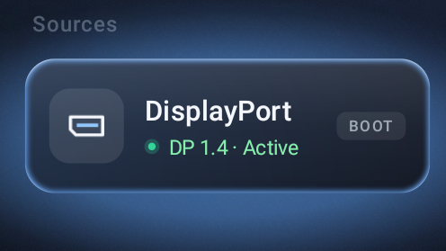
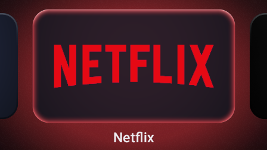
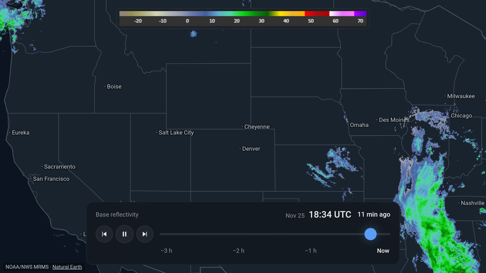

# MinimalTVLauncher

An ultra-lightweight (~62 KiB APK), zero-dependency, ad-free open-source Android TV launcher built for Smart Monitors (tested on the **KTC A32Q8** / Realtek `RTD2851F`).

Designed to replace sluggish, ad-heavy Google TV launchers on low-RAM (2 GB) smart monitors with an **Obsidian Spatial** aesthetic, native hardware input switching (**DisplayPort**, **USB-C**, **HDMI**), and **auto-boot directly into your PC input**.

### Home Menu


Focus detail on the KTC A32Q8: DisplayPort (left) and Netflix (right).

<p align="center">
  
  
</p>

### Built-in MRMS Weather Radar Screensaver


## Features

- **Obsidian Spatial Aesthetic (Zero Blur Overhead)**:
  - **Ambient & Backlit Optics**: Overhead lighting on resting cards, an aspect-matched accent backlight behind the selection, and a cached `64×64` noise texture to reduce panel banding.
  - **Cinema 16:9 App Gallery**: Focused tiles have a crisp ice-like edge: the outer lip catches the backlight, and the curved bevel refracts a narrow strip of the banner while the flat face stays sharp. Includes full-bleed `16:9` artwork, rest-state dimming (`0.82×` → `1.0×`), and focus-reveal titles.
  - **Automatic Obsidian Banner Remapping & Bespoke System Lockups**: Automatically converts blinding white-slab Leanback banners (e.g., *Netflix*, *Play Store*, *YouTube*) into cohesive dark obsidian cards via linear-light unmixing while preserving brand colors and enclosed cutouts, alongside custom dark-glass vector lockups for stock utilities (*Media Player*, *Miracast*).
  - **Frosted Glass Control Capsule**: Quiet 3-chip top-lit glass bar (`Radar`, `Zzz`, `Boot · DP`) paired with a standalone circular glass `Settings` button and a tabular-numeral live clock.
- **Native Smart Monitor Sources**: Dynamically discovers hardware passthrough inputs via Android's `TvInputManager` (**DisplayPort**, **USB-C**, **HDMI 1**) with unified `12-o'clock` & backlit bevel rims, subtle port-accent inner washes, active-signal emerald LEDs, a recessed `BOOT` micro-tag, and a ghost-glass `All Inputs` OSD tile.
- **Live MRMS Weather Radar Screensaver & On-Demand Viewer (`Radar`)**:
  - Registers a native Android TV `DreamService` (`RadarDreamService`) displaying your live [MRMS Weather Radar](https://jvaldivia23.github.io/personal_webpage/radar/) in a hardware-accelerated WebView with auto-looping scans.
  - **PC / DisplayPort Safe**: Realtek's hardware passthrough wake lock + an explicit passthrough guard ensure the Android screensaver **never** interrupts active DisplayPort / USB-C / HDMI workstation use.
  - **Zero RAM Leak**: Runs in an isolated `:radar` process that terminates immediately on exit/wake, returning 100% of Chromium WebView memory back to the OS (Home launcher stays at ~47 MB PSS / ~0.8 MB Java heap).
  - **Interactive Remote Controls**: Click **`Radar`** in the top bar anytime (`OK` = Play/Pause, `Up/Down` = Zoom, `Left/Right` = Step scan, `Back` = Close).
- **Built-in Hardware Sleep Timer (`☾ Zzz`)**:
  - Click the top-bar **`☾ Zzz`** chip to cycle presets (`OFF` → `15m` → `30m` → `45m` → `60m` → `90m` → `120m` → `OFF`), or **long-press** to cancel immediately.
  - Displays a live countdown in the header (`30m` → `0:59`), warns 1 minute before sleep, and triggers Realtek's native `sleeptimer.SleepTimerRecevier` suspend via `AlarmManager` so it works even after switching to Netflix, YouTube, or DisplayPort.
- **Auto-Boot to Any Input (`Boot · DP / USB-C / HDMI 1 / Off`)**:
  - Click the top-bar **`Boot · ...`** chip to cycle through `DP` → `USB-C` → `HDMI 1` → `Off`.
  - Or **long-press** any source tile to set it as the default boot input immediately.
  - Uses both `BOOT_COMPLETED` (`BootReceiver`) and cold-boot uptime fallback so your monitor jumps straight to your workstation on power-on.
- **Ultra-Low Footprint**: ~62 KiB compiled APK, ~0.8 MB Java heap (~47 MB total PSS), zero Gradle bloat, zero ads, zero telemetry/Firebase.

## Requirements

- **JDK 17** (`jdk17-openjdk`)
- **Android SDK** (`platforms;android-34` and `build-tools;34.0.0` at `$ANDROID_HOME`, defaults to `~/Android/Sdk`)
- **ADB** (`android-tools`)

## Build & Install

```bash
# Build APK only (outputs build/ktc-launcher.apk)
./build.sh

# Build and install directly over Wireless ADB
./build.sh --install <monitor-ip>:5555
```

A local signing keystore (`ktc-launcher.keystore`, git-ignored) is automatically generated on first build.

## Setting as Default Launcher (via ADB)

1. Enable **Developer Options -> USB/Network Debugging** on your Android TV / Smart Monitor.
2. Install the APK with `./build.sh --install <ip>:5555`.
3. Disable the stock Google TV launcher and set `MinimalTVLauncher` as the default `HOME` activity:
   ```bash
   adb connect <ip>:5555
   adb -s <ip>:5555 shell pm disable-user --user 0 com.google.android.apps.tv.launcherx
   adb -s <ip>:5555 shell pm disable-user --user 0 com.google.android.tungsten.setupwraith
   adb -s <ip>:5555 shell cmd package set-home-activity com.ktc.launcher/.MainActivity
   ```
   *(100% reversible at any time via `adb shell pm enable com.google.android.apps.tv.launcherx`.)*

4. *(Optional)* Set `RadarDreamService` as your system screensaver (10-minute Android TV idle timeout):
   ```bash
   adb -s <ip>:5555 shell settings put secure screensaver_enabled 1
   adb -s <ip>:5555 shell settings put secure screensaver_components com.ktc.launcher/com.ktc.launcher.RadarDreamService
   adb -s <ip>:5555 shell settings put system screen_off_timeout 600000
   adb -s <ip>:5555 shell settings put global stay_on_while_plugged_in 0
   ```

### Optional: Free Extra RAM on Low-Memory Smart Monitors (e.g., KTC A32Q8)

Keep your streaming apps installed while stopping them from idling in the background, disable unused voice services, and speed up transitions:

```bash
# Disable voice assistant & unused system bloat (never disable com.realtek.* monitor drivers!)
for pkg in com.google.android.katniss com.google.android.tts com.google.android.marvin.talkback com.android.traceur com.android.dreams.basic; do
  adb -s <ip>:5555 shell pm disable-user --user 0 "$pkg"
done

# Restrict streaming apps from running in the background when closed
for pkg in com.netflix.ninja com.google.android.youtube.tv com.disney.disneyplus com.amazon.amazonvideo.livingroom com.hulu.livingroomplus com.wbd.stream com.peacocktv.peacockandroid com.spotify.tv.android; do
  adb -s <ip>:5555 shell cmd appops set "$pkg" RUN_IN_BACKGROUND ignore
  adb -s <ip>:5555 shell cmd appops set "$pkg" RUN_ANY_IN_BACKGROUND ignore
done

# Snappier UI animations
adb -s <ip>:5555 shell settings put global window_animation_scale 0.25
adb -s <ip>:5555 shell settings put global transition_animation_scale 0.25
adb -s <ip>:5555 shell settings put global animator_duration_scale 0.25
```

## License

MIT — see [LICENSE](LICENSE).
